<p align="center">
  
</p>

<h1 align="center">Void Frontier</h1>

<p align="center"><strong>No friction. No brakes you didn't fire yourself.</strong></p>

<p align="center">
  <a href="https://gamestudio42.github.io/void-frontier/"></a>
  <a href="https://github.com/gamestudio42/void-frontier/actions/workflows/pages.yml"></a>
  <a href="https://github.com/gamestudio42"></a>
</p>

<p align="center">
  A Newtonian space action RPG for the browser. Fly a small working ship around Outpost Alpha,
  a frontier station on the edge of an asteroid belt, where every change of speed or direction
  comes from a thruster you fired and every rock is solid. Mining, trading, contracts and
  pirates are on the way.
</p>

<p align="center">
  <a href="https://gamestudio42.github.io/void-frontier/">
    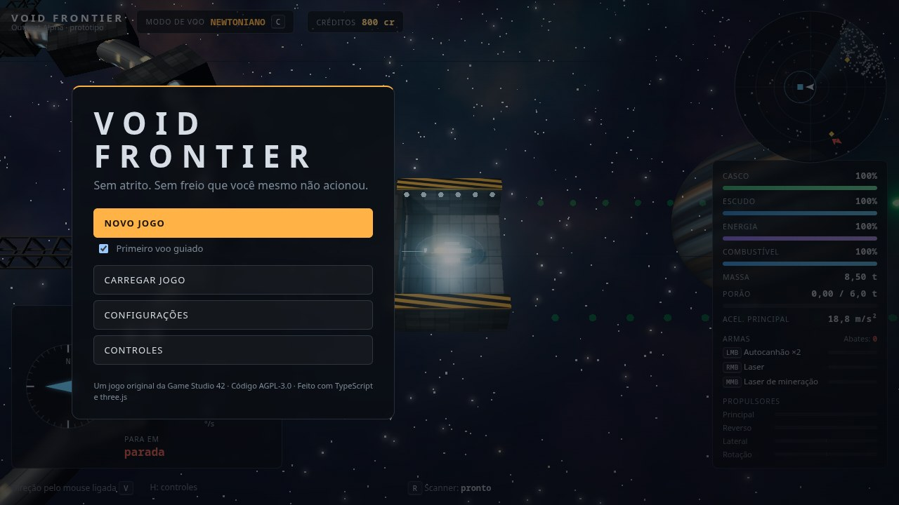
  </a>
</p>

<p align="center">
  <a href="https://gamestudio42.github.io/void-frontier/">
    
  </a>
</p>

## Fly it

1. **Thrust and coast.** `W` fires the main engine. Let go and the ship keeps its speed forever. `S` fires the reverse thrusters, `A` and `D` the lateral ones.
2. **Point anywhere.** The nose follows the mouse (toggle with `V`, or turn with `Q` and `E`). Turning never changes where you are going: the blue line is your nose, the amber line is your path.
3. **Stop on purpose.** Hold `Space` to fire every thruster against your motion. The red ring shows where you would stop.
4. **Mine.** Press `R` to scan nearby rocks, then cut ore with the mining laser (middle mouse or `X`). The tractor pulls the chunks into your hold, and every tonne you carry makes the ship slower to accelerate and turn.
5. **Ask for help.** `C` switches on flight assist, which cancels drift and spin for you, using the same thrusters and the same fuel.
6. **Fight.** Pirates patrol the sector. Left mouse fires the autocannons, right mouse the laser, `Tab` picks a target. Burn shields with the laser, break the hull with the guns, and lead your shots: the guns swivel onto the yellow marker when it is close to your nose.
7. **Take contracts.** The station's board offers deliveries to relay beacons, ore orders and pirate bounties, with deadlines and rewards. Reputation grows with every job done and unlocks better ones.
8. **Trade and upgrade.** Fly back into the station's bay slowly and lined up, press `F` to dock, sell your ore and salvage, repair, refuel and buy upgrades. Prices follow the station's stock.
9. **Go further.** Four sectors are linked by jump gates: the Industrial Belt's refinery pays best for ore, Pirate Territory hides wrecks and caches behind gunships, and the Anomaly Zone's gravity well guards the rarest crystals. `M` opens the sector map.
10. **Build your ship.** Shots break what they hit: engines at the tail, sensors and guns at the nose, reactor and hold amidships. Fit modules into engine, utility and defence slots, earn standing with the Outpost Authority and the Ferrum Combine, and unlock their best equipment.
11. **Watch the lanes.** Haulers carry ore and parts between stations while pirates hunt them; shortages, raids and mineral rushes move prices. Escort a convoy, or profit from the gap a lost one leaves.
12. **Mind the rocks.** Asteroids and the station are solid. Bump them gently and you bounce; hit them fast and the hull gives way. The radar, the nearest-object readout and the collision warning help you thread the field. `R` relaunches a lost ship.

<p align="center">
  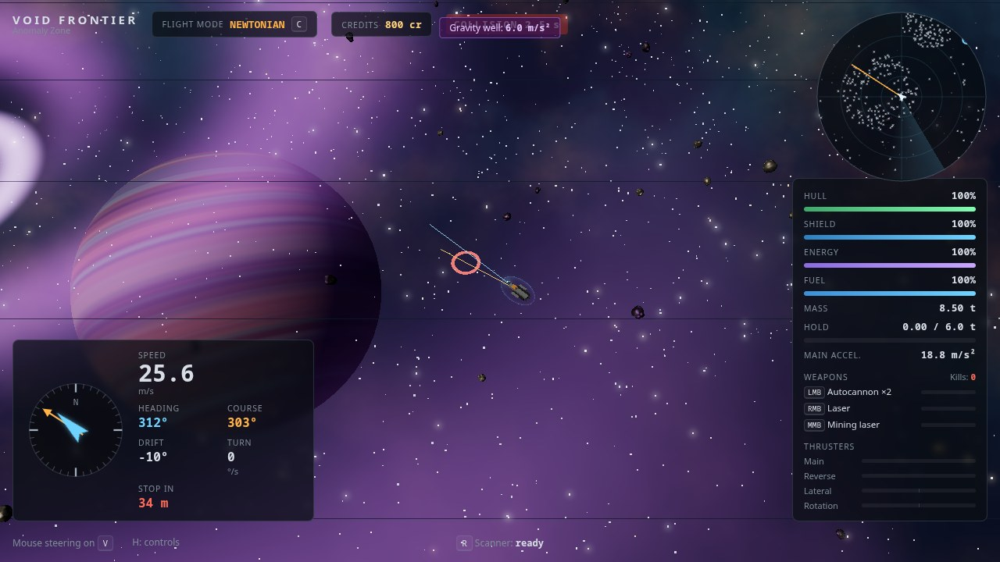
</p>

<p align="center">
  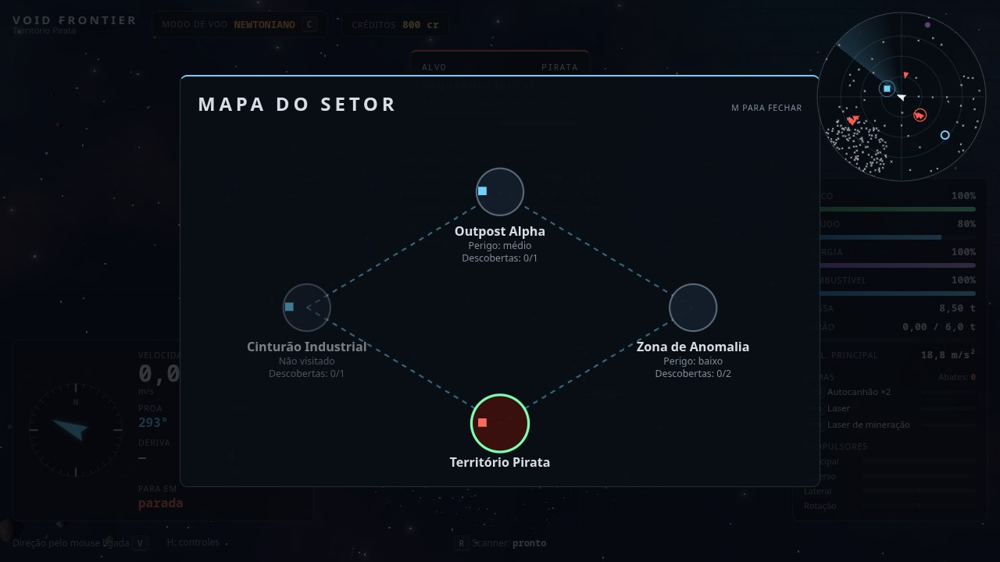
</p>

<p align="center">
  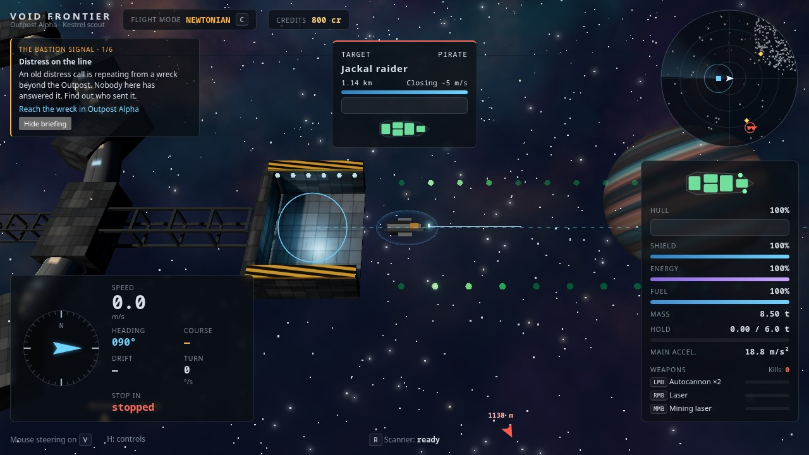
</p>

<p align="center">
  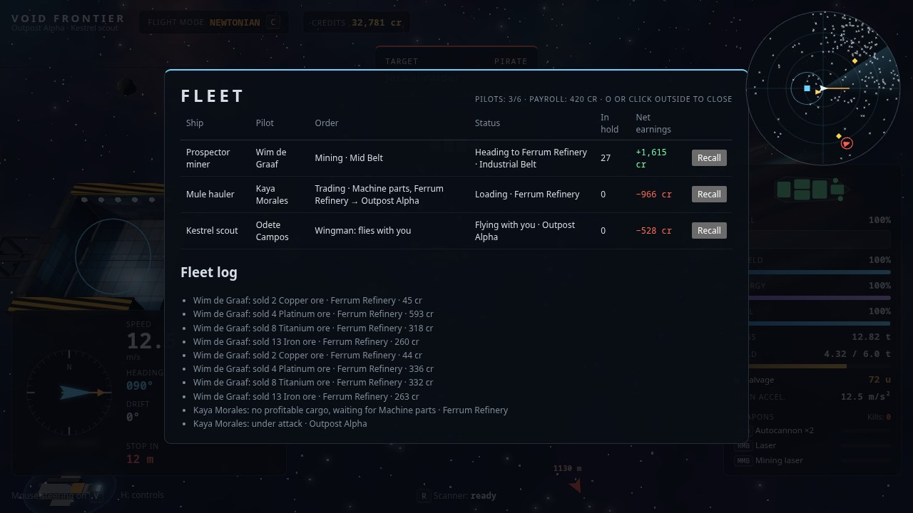
</p>

<p align="center">
  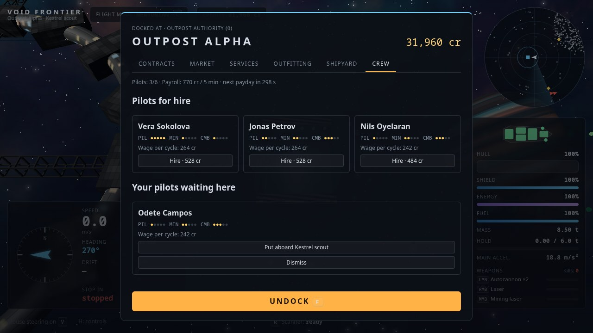
</p>

<p align="center">
  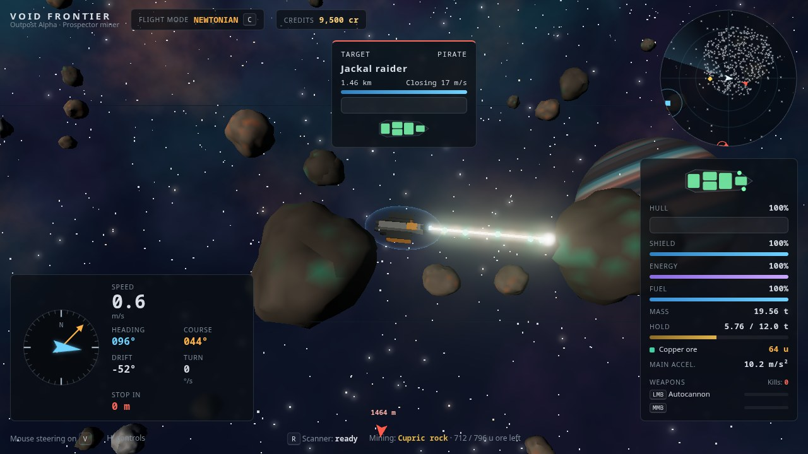
</p>

<p align="center">
  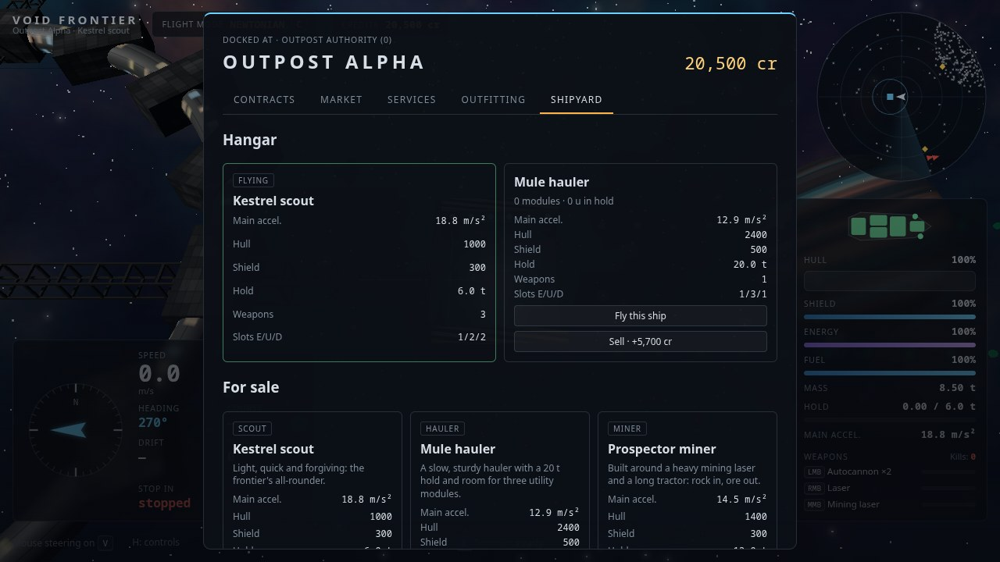
</p>

<p align="center">
  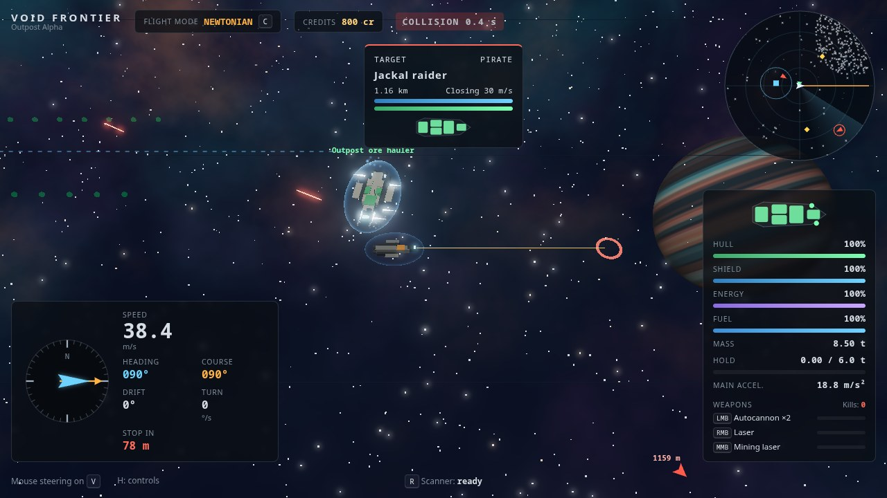
</p>

<p align="center">
  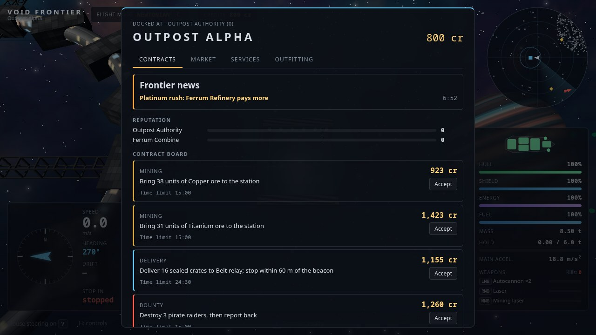
</p>

<p align="center">
  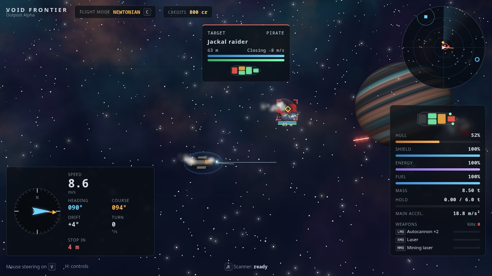
</p>

<p align="center">
  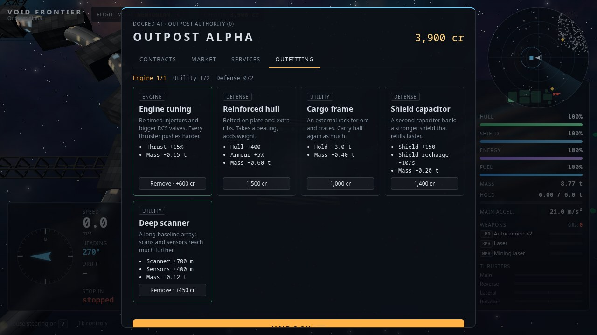
</p>

<p align="center">
  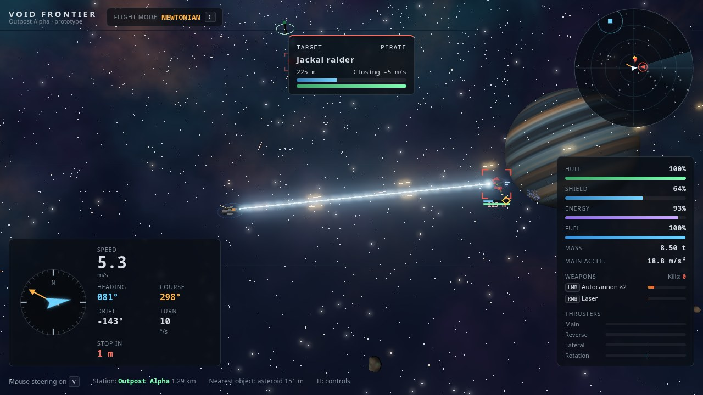
</p>

<p align="center">
  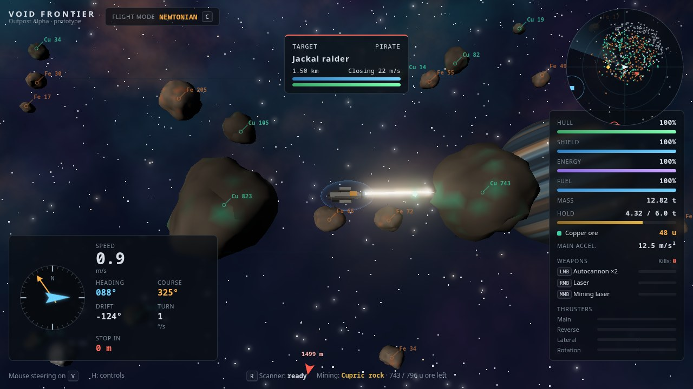
</p>

<p align="center">
  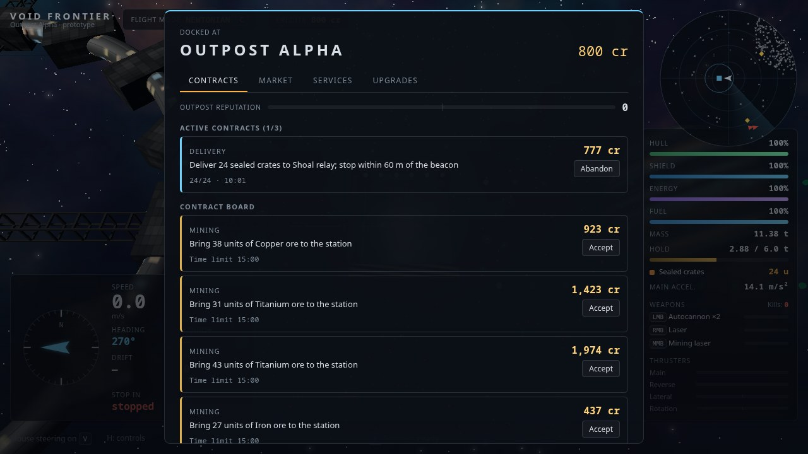
</p>

<p align="center">
  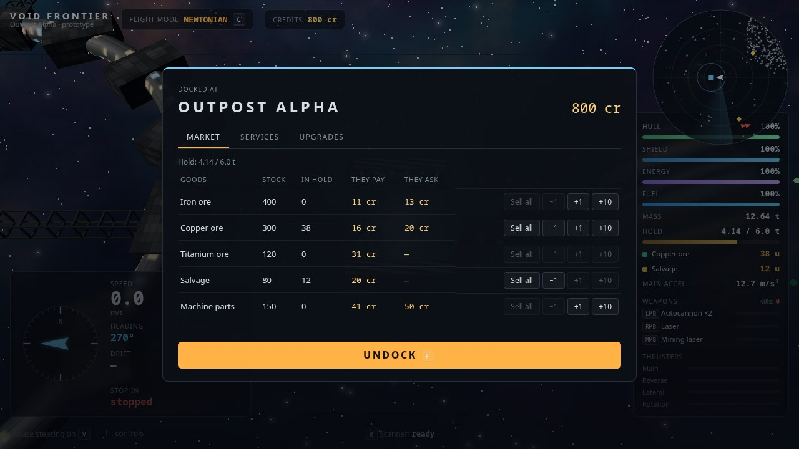
</p>

<p align="center">
  
</p>

New players get a guided first flight that teaches each of these by doing it. Progress saves automatically when you dock; `Esc` opens the pause menu with three save slots, export and import, and settings for graphics, audio, camera shake and language. The game opens in Portuguese for Portuguese-language browsers and in English otherwise.

## Status

**0.7: a story to follow.** The Bastion Signal is a six-mission campaign from a distress call near the Outpost to the warlord's flagship, with a new military station, Bastion Watch, in the Anomaly Zone. This builds on 0.6 (pilots and fleet orders), 0.5 (owning several ships), 0.4 (living economy), 0.3 (subsystems, factions, outfitting), 0.2 (four sectors and gates) and the 0.1 vertical slice. See the [roadmap](docs/ROADMAP.md).

## Develop

With Node.js 22 and pnpm 10:

```sh
pnpm install
pnpm dev      # http://localhost:5173
pnpm check    # typecheck, lint and unit tests
pnpm e2e      # Playwright flight tests
pnpm build    # static build in apps/game/dist
```

The simulation is pure, deterministic TypeScript in `packages/simulation`, separate from the three.js renderer and the React HUD. Read [AGENTS.md](AGENTS.md), the [design](docs/GDD.md) and the [architecture](docs/ARCHITECTURE.md) before contributing.

## License

Code: [AGPL-3.0-or-later](LICENSE). Documentation: CC-BY-4.0. All current visuals (ships, station, asteroids, nebula, textures) are generated by the code; see [docs/assets.md](docs/assets.md).

Void Frontier is an original game. Its flight model is inspired by the Newtonian space-sim genre; it uses no names, art or code from other games.
