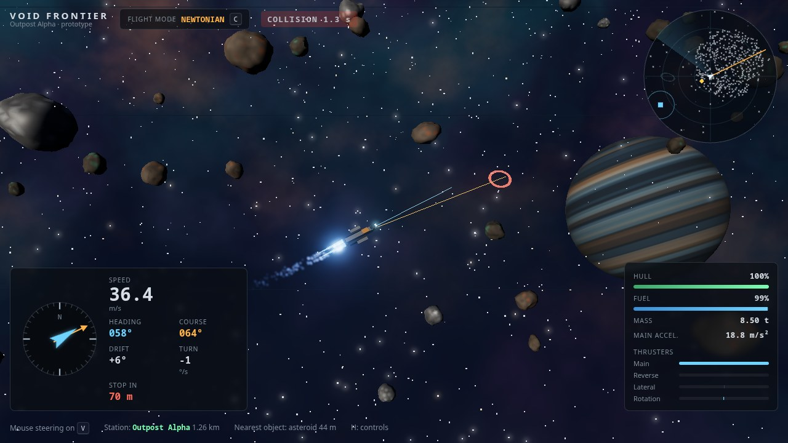
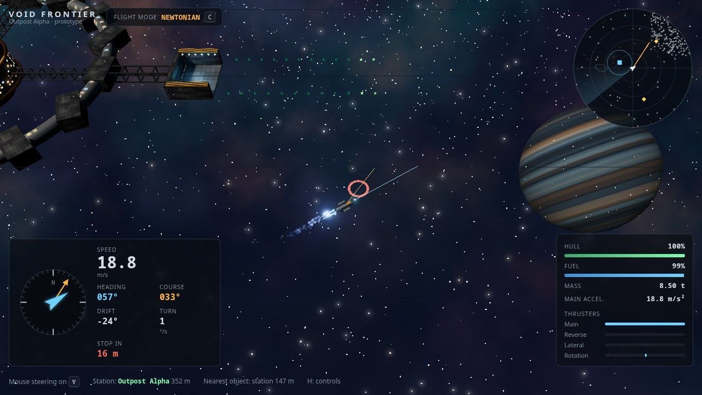

<p align="center">
  
</p>

<h1 align="center">Void Frontier</h1>

<p align="center"><strong>No friction. No brakes you didn't fire yourself.</strong></p>

<p align="center">
  <a href="https://gamestudio42.github.io/void-frontier/"></a>
  <a href="https://github.com/gamestudio42/void-frontier/actions/workflows/pages.yml"></a>
  <a href="https://github.com/gamestudio42"></a>
</p>

<p align="center">
  A Newtonian space action RPG for the browser. Fly a small working ship around Outpost Alpha,
  a frontier station on the edge of an asteroid belt, where every change of speed or direction
  comes from a thruster you fired and every rock is solid. Mining, trading, contracts and
  pirates are on the way.
</p>

<p align="center">
  <a href="https://gamestudio42.github.io/void-frontier/">
    
  </a>
</p>

## Fly it

1. **Thrust and coast.** `W` fires the main engine. Let go and the ship keeps its speed forever. `S` fires the reverse thrusters, `A` and `D` the lateral ones.
2. **Point anywhere.** The nose follows the mouse (toggle with `V`, or turn with `Q` and `E`). Turning never changes where you are going: the blue line is your nose, the amber line is your path.
3. **Stop on purpose.** Hold `Space` to fire every thruster against your motion. The red ring shows where you would stop.
4. **Feel the load.** Press `L` to take on 5 t of test cargo and compare how the ship accelerates and turns.
5. **Ask for help.** `C` switches on flight assist, which cancels drift and spin for you, using the same thrusters and the same fuel.
6. **Mind the rocks.** Asteroids and the station are solid. Bump them gently and you bounce; hit them fast and the hull gives way. The radar, the nearest-object readout and the collision warning help you thread the field. `R` relaunches a lost ship.

<p align="center">
  
</p>

The game opens in Portuguese for Portuguese-language browsers and in English otherwise; switch on the controls panel (`H`).

## Status

**Milestone 2 of 7: environment.** Outpost Alpha: a modular station with a docking bay, three asteroid fields with three rock types, continuous collision detection with bounce, spin and hull damage, ship destruction and relaunch, radar, procedural nebula, shadows, engine and impact particles and adaptive graphics quality (`G`). Milestone 1 delivered the flight model. Combat, mining, docking, the economy and missions follow; see the [roadmap](docs/ROADMAP.md).

## Develop

With Node.js 22 and pnpm 10:

```sh
pnpm install
pnpm dev      # http://localhost:5173
pnpm check    # typecheck, lint and unit tests
pnpm e2e      # Playwright flight tests
pnpm build    # static build in apps/game/dist
```

The simulation is pure, deterministic TypeScript in `packages/simulation`, separate from the three.js renderer and the React HUD. Read [AGENTS.md](AGENTS.md), the [design](docs/GDD.md) and the [architecture](docs/ARCHITECTURE.md) before contributing.

## License

Code: [AGPL-3.0-or-later](LICENSE). Documentation: CC-BY-4.0. All current visuals (ships, station, asteroids, nebula, textures) are generated by the code; see [docs/assets.md](docs/assets.md).

Void Frontier is an original game. Its flight model is inspired by the Newtonian space-sim genre; it uses no names, art or code from other games.
